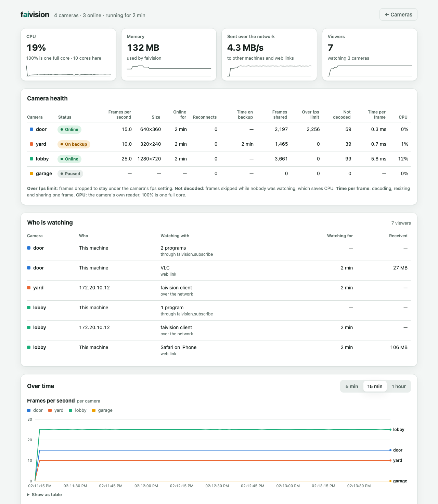

# faicam

**Manage your cameras from a web page. faistream shares each one with everything that
watches it.**

faicam is the camera-management side of [faistream](../faivision): add a camera by its IP
address and brand, check that it works, watch it from any phone, TV or computer, and see
who is watching. The streaming is faistream's: each camera is read and decoded once, and
every viewer and program gets the newest frame from that single connection.

## Quick start

```bash
pip install faicam
faicam
```

Open **http://localhost:7380**, click **Add camera**, and enter the camera's IP address,
username and password. faicam finds the video stream for common brands (Hikvision, Dahua,
Hanwha/Wisenet, Axis, Reolink, Uniview, Tapo, Foscam) and shows a picture before you save.
Have a stream address instead? Choose **RTSP address** and paste it; if it doesn't play, the
page says why in plain words, for example a wrong password or an address that only accepts
uploads. Another camera can be a backup, used while the first is offline.


Each camera card has **Edit**, **Pause** (stops the camera for everyone until you resume
it), **Copy link** and **Remove**. Programs still use faistream directly:
`faistream.subscribe("door")`.

## Watch on other devices

Every camera has a web address: `http://localhost:7380/live/door.mjpg` for live video and
`/snapshot/door.jpg` for the latest picture. They open in a browser, VLC, OBS and
`cv2.VideoCapture(...)`, and take `?width=`, `?quality=` and (for `/live`) `?fps=`.

To watch on a phone, a TV or another computer, turn on **Settings → Camera links → Phones,
TVs and other computers can open them too**. Links only show video, so the page where
cameras are changed can stay on this computer. Viewers can be asked for a password.

## Stats

**Stats** (`/stats`) shows each camera's health (frame rate, time online, reconnects, time
on a backup, CPU), who is watching (programs, other machines and web links with their app),
faicam's CPU, memory and network use, and charts of the last hour.



## Settings

The page saves everything in `cameras.yaml`, and **Settings → Edit all settings as YAML**
shows the whole file. It's faistream's settings plus cameras by IP address and the page:

```yaml
cameras:
  door:
    ip: 192.168.1.21
    username: admin
    password: ${DOOR_PASS}     # read from the environment
    brand: hikvision
    backup: yard
  replay:
    source: ./recordings/lobby.mp4   # anything faistream reads
ui:
  links: network               # phones and TVs can open camera links
```

See [`configs/example.yaml`](configs/example.yaml) for every option. The file holds
passwords, so faicam saves it readable only by you; the page never sends camera passwords
to the browser.

## Development

```bash
uv sync                  # uses ../faivision (faistream) while both are side by side
uv run pytest
uv run ruff check . && uv run mypy src tests
uv run faicam            # http://localhost:7380
```

The pages are in [`frontend/`](frontend/) (Preact, TypeScript, Vite). Only changing them
needs Node.js 20.19 or newer:

```bash
cd frontend && npm install
npm run dev      # http://localhost:5173 with instant reload, talking to a running faicam
npm run build    # type-checks, then writes src/faicam/static (commit it)
```

```text
src/faicam/
  cli.py         faicam [cameras.yaml]: runs faistream and the page together
  config.py      cameras by IP and brand, the page's settings, editing cameras.yaml
  brands.py      camera brands, stream addresses, detection
  rtsp_check.py  asks an RTSP server why a stream won't play
  server.py      pages, API and camera links
  access.py      who may open the page, and who may open camera links
  editor.py      what the forms and YAML editor change, and when to restart
  stats.py       the stats page's numbers
  templates/     the error page
  static/        the built pages (from frontend/; don't edit)
```

Step-by-step checks with real cameras: [docs/testing.md](docs/testing.md).

## License

MIT
